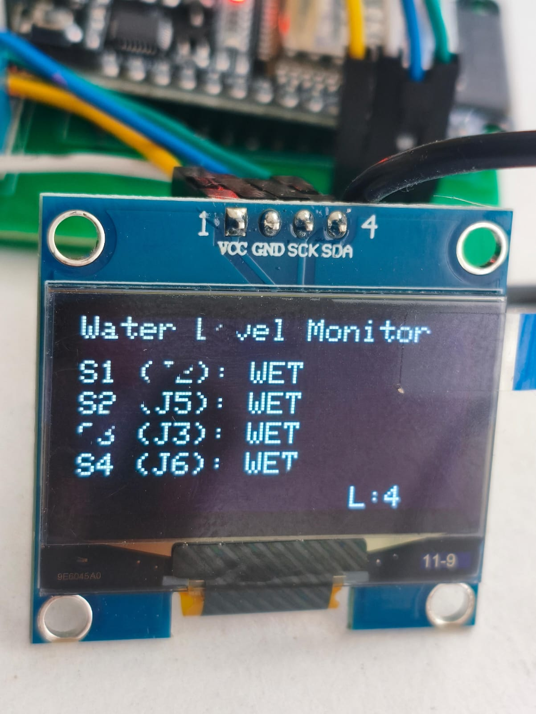
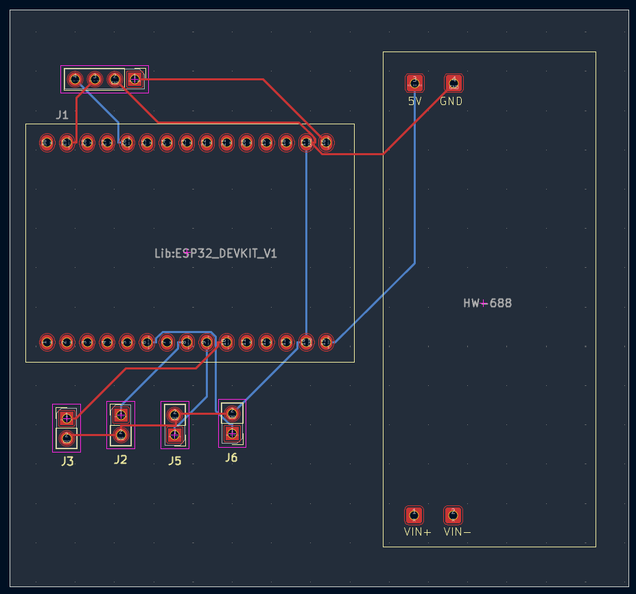
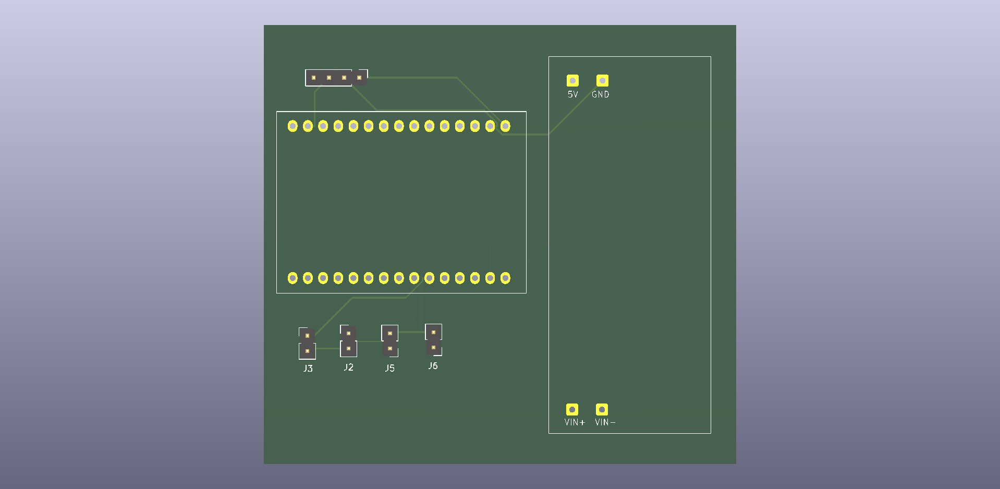

# ESP32 Water Level Monitor

A 4-level water monitoring system built around an ESP32, with a custom KiCad-designed PCB, four float level sensors, an OLED display and a buck converter power supply.

## Features
- Detects water level using 4 float sensors (S1 to S4)
- Live status on a 1.3" I2C OLED: each sensor shows WET or DRY, plus the overall level (L:0 to L:4)
- Custom PCB designed in KiCad, with Gerber files included
- Powered from 12V through a buck converter (HW-688 module, 5V output)

## Hardware
| Component | Details |
|---|---|
| Microcontroller | ESP32 DevKit V1 (30-pin) |
| Sensors | 4 x float level sensors (connectors J2, J3, J5, J6) |
| Display | 1.3" I2C OLED (SH1106) |
| Power | 12V input, HW-688 buck converter module (5V output) |
| PCB | Custom 2-layer board designed in KiCad |

## Pin connections
| Signal | ESP32 pin |
|---|---|
| Sensor 1 to 4 | GPIO 25, 26, 27, 32 (common GND) |
| OLED SDA | GPIO 21 |
| OLED SCL | GPIO 22 |
| OLED VCC | 3.3V |

## Photos
**OLED output (all 4 sensors wet, level 4)**

**Assembled PCB**

## PCB design

## Repository structure
- `firmware/`: ESP32 code (Arduino IDE)
- `hardware/kicad-project/`: KiCad project files
- `hardware/schematic/`: schematic
- `hardware/gerber/`: Gerber and drill files for PCB fabrication
- `hardware/pcb-images/`: PCB layout and 3D view
- `images/`: project photos

## How it works
Each float sensor closes a contact when the water reaches it. The ESP32 reads the four inputs and counts how many sensors are wet. That count is shown as the water level (L:0 to L:4) on the OLED, along with the state of each sensor.

## Getting started
1. Open `firmware/water_level_monitor/water_level_monitor.ino` in the Arduino IDE.
2. Install the libraries Adafruit GFX and Adafruit SH110X.
3. Select your ESP32 board and upload.
4. Connect the sensors to J2, J3, J5 and J6 and power the board with 12V.

## Author
Sharanakumar Gadag, Electronics and Communication Engineering
